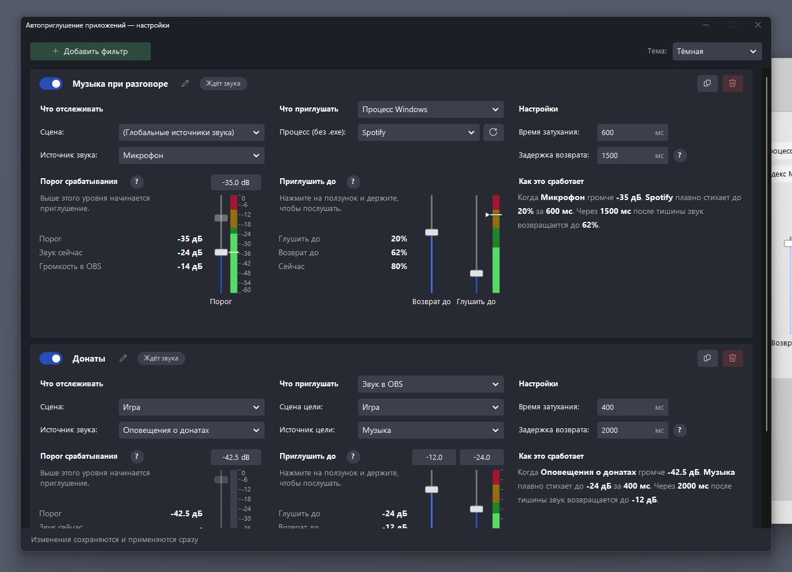

# Автоприглушение приложений для OBS Studio

*(App Audio Ducking)*

Плагин для **OBS Studio** (Windows). Вы говорите в микрофон, и плагин плавно приглушает игру, музыку или браузер, чтобы они не перебивали голос. Замолчали, и громкость так же плавно возвращается.

## Возможности

- Любое число **фильтров**: «когда в этом источнике OBS есть звук, приглушить вот это».
- Приглушать можно **процесс Windows** (Spotify, браузер, игра) или **звуковой источник OBS** (музыка в сцене).
- Плавное затухание и возврат. **Задержка возврата** не даёт музыке «дёргаться» в паузах речи.
- Можно приглушать не до тишины, а до нужного уровня, и возвращать до любого уровня.
- Живые индикаторы уровня и **прослушивание**: зажмите ползунок, и громкость цели встанет на его уровень.
- Настройки сохраняются сами. Тёмная и светлая тема, русский и английский язык (по языку OBS).
- Если OBS закрылся или упал во время приглушения, громкость вернётся при следующем запуске.

## Установка

Нужны Windows 10/11 и OBS Studio (проверялось на 32.2.2). .NET на компьютере ставить не нужно.

1. Скачайте `SmoothMuterPlugin.dll` со страницы [Releases](../../releases) (или [соберите сами](docs/development.md)).
2. Закройте OBS и скопируйте файл в папку плагинов: `<папка OBS>\obs-plugins\64bit`
   (для Steam-версии: `C:\Program Files (x86)\Steam\steamapps\common\OBS Studio\obs-plugins\64bit`).
3. Запустите OBS. Плагин появится в меню **Сервис → Автоприглушение приложений** (в английском OBS: **Tools → App Audio Ducking**).

## Быстрый старт

1. Откройте **Сервис → Автоприглушение приложений** и нажмите **Добавить фильтр**.
2. **Что отслеживать.** Сцена `(Глобальные источники звука)` и источник вашего микрофона. Это то, чей уровень слушает плагин.
3. **Что приглушать.** Выберите `Процесс Windows` и начните вводить имя приложения (например, `Spotify`). Или выберите `Звук в OBS` и укажите источник.
4. **Порог.** Подвиньте ползунок слева так, чтобы линия была выше фонового шума, но ниже вашего голоса. Следите за индикатором: когда вы говорите, он должен подниматься выше линии.
5. Готово. Сохранять ничего не нужно, плагин применяет настройки сам.

Основные параметры:

| Параметр | Что значит |
|---|---|
| **Порог срабатывания** | Приглушение включается, когда звук в источнике громче этого уровня |
| **Глушить до** | До какого уровня опускать громкость (внизу полная тишина) |
| **Возврат до** | До какого уровня возвращать. Пока не трогали, возвращается к исходной громкости |
| **Время затухания** | За сколько миллисекунд громкость меняется (по умолчанию 600) |
| **Задержка возврата** | Сколько миллисекунд ждать тишины перед возвратом (по умолчанию 1500) |

Подробное описание каждого поля: [docs/settings.md](docs/settings.md).

## Если что-то не работает

- **Приложение не глушится.** Проверьте, что оно сейчас играет звук, а имя процесса указано как в Диспетчере задач (без `.exe`). Управление идёт только на устройстве вывода Windows по умолчанию.
- **Индикатор серый.** Источник не выбран, не найден или находится в неактивной сцене («Сцена неактивна»).
- **Приглушение не включается.** Уровень не доходит до порога: опустите порог.
- **Приглушение не выключается.** Фоновый шум источника выше порога: поднимите порог.
- **Звук «дёргается».** Увеличьте задержку возврата.

Журнал плагина: `%LOCALAPPDATA%\Temp\ProcessMuter_debug.log`. Расшифровка записей: [docs/files-and-config.md](docs/files-and-config.md).

## Что стоит знать

- Если вы сами меняете громкость приглушённого приложения в микшере Windows, при возврате она будет заменена той, что была до приглушения.
- Источник, за которым следит фильтр, нельзя выбрать его же целью.
- После переименования сцены или источника в OBS выберите его в фильтре заново.

Остальные ограничения и устройство плагина: [docs/how-it-works.md](docs/how-it-works.md).

## Документация

| Документ | О чём |
|---|---|
| [docs/settings.md](docs/settings.md) | Все поля и ползунки окна настроек |
| [docs/how-it-works.md](docs/how-it-works.md) | Как работает плагин, ограничения, надёжность |
| [docs/files-and-config.md](docs/files-and-config.md) | Где лежат файлы, журнал, формат `config.json` |
| [docs/development.md](docs/development.md) | Сборка из исходников, тесты, структура проекта |
