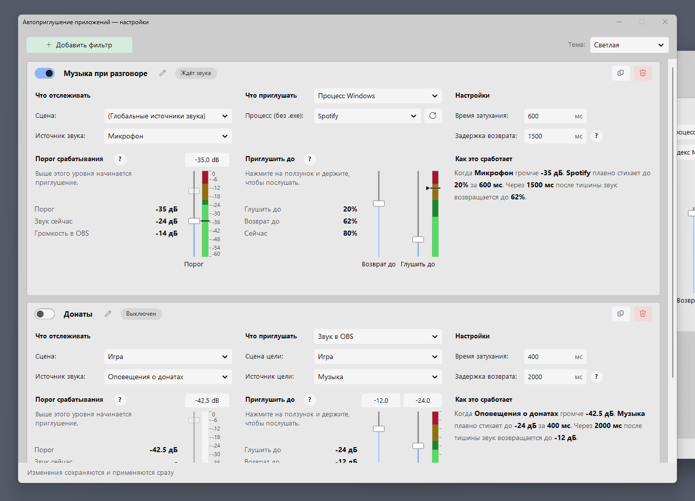
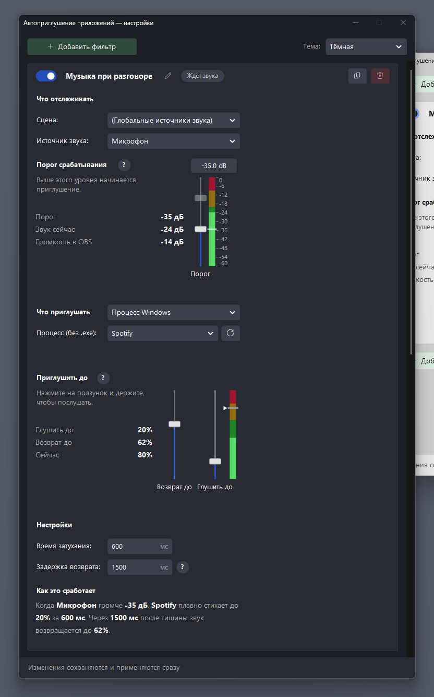
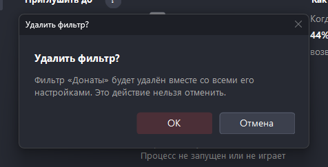

# Окно настроек: все поля и ползунки

Откройте **Сервис → Автоприглушение приложений** (в английском OBS **Tools → App Audio Ducking**). Окно показывает список фильтров. Каждый фильтр это карточка из трёх блоков: **что отслеживать**, **что приглушать** и **настройки**.

Сохранять ничего не нужно: правки записываются и применяются сами примерно через полсекунды после последнего изменения (внизу на пару секунд появляется «Сохранено»). Пока вы держите ползунок мышью, сохранение ждёт, пока вы его отпустите. Окно можно закрыть в любой момент, последние правки записываются при закрытии.

## Шапка фильтра

| Элемент | Что делает |
|---|---|
| Переключатель слева | Выключенный фильтр остаётся в списке, но ничего не глушит, а его цель возвращается к исходной громкости (если её не глушит другой включённый фильтр) |
| Название | Щёлкните по нему, чтобы переименовать. У нового фильтра это «Фильтр 1», «Фильтр 2» и так далее |
| Плашка состояния | «Приглушает» (цель сейчас приглушена или возвращается), «Ждёт звука», «Выключен», «Не настроен» (не выбран источник или цель) |
| Значок «Дублировать» | Создаёт копию сразу после этого фильтра с названием «… (копия)» |
| Значок «Удалить» | Удаляет фильтр после подтверждения (**ОК** или **Отмена**) |

Кнопка **Добавить фильтр** есть сверху и в конце списка. Справа вверху выбирается **тема** окна (тёмная или светлая), выбор запоминается.

## Что отслеживать

| Поле | Описание |
|---|---|
| **Сцена** | Сцена OBS, где находится источник. Пункт `(Глобальные источники звука)` показывает микрофон и звук рабочего стола |
| **Источник звука** | Звуковой источник, за уровнем которого следит плагин. Список заполняется после выбора сцены (вложенные сцены и группы включены) |
| **Порог срабатывания** | Приглушение начинается, когда уровень источника выше ползунка. Ползунок двигается мышью, колесом и стрелками, число можно ввести в поле над индикатором (от 0 до -60 дБ). Полупрозрачный ползунок только показывает, как выставлен фейдер этого источника в OBS |

Индикатор показывает живой уровень источника. Он серый, если источник не выбран, не найден или находится в неактивной сцене («Сцена неактивна»): OBS обычно не передаёт звук таких источников, и приглушение по ним не сработает, пока сцена не станет активной. Для глобальных источников этого ограничения нет.

## Что приглушать

Сначала выберите вид цели:

- **Процесс Windows** — приложение, звук которого глушится. Введите имя без `.exe` (начните печатать, и список запущенных процессов отфильтруется). Кнопка обновления рядом перечитывает список, если приложение запущено уже после открытия окна. Имя можно посмотреть в Диспетчере задач, вкладка «Подробности».
- **Звук в OBS** — звуковой источник OBS (например, музыка в сцене). Выберите **сцену цели** и **источник цели**. Источник, за которым следит фильтр, в списке не показывается: его громкость влияла бы на измеряемый уровень.

Под полями находится индикатор: цветная шкала с живым уровнем звука цели и два ползунка рядом с ней:

- **Глушить до** (правый) — до какого уровня опускать громкость. Нижнее положение это полная тишина.
- **Возврат до** (левый) — до какого уровня вернуть громкость, когда звук в источнике пропал. Пока вы его не трогали, звук возвращается к исходной громкости. Двойной щелчок по ползунку снова включает «до исходной».
- **Чёрта на цветной шкале** — текущая громкость цели (у процесса Windows это громкость в микшере Windows, у источника OBS положение его фейдера). Она двигается по той же шкале, где бежит живой уровень звука, и сама следует за громкостью, в том числе пока вы держите ползунок. Мышью её двигать нельзя. То же число есть в списке значений слева («Сейчас»).

Шкала для источника OBS в дБ (от 0 до -60), для процесса Windows в процентах (от 0 до 100). «Возврат до» не бывает ниже «Глушить до»: если поднять «Глушить до» выше, возврат поднимется вместе с ним.

**Прослушивание.** Пока вы держите любой из ползунков мышью (двигать не нужно), громкость цели стоит ровно на его уровне: можно включить музыку и послушать. Когда ползунок отпущен, громкость сразу возвращается. Колесо мыши, клавиши и ввод числа меняют громкость на полторы секунды. Приглушение «до уровня» никогда не делает звук громче: если цель и так тише, она остаётся как есть.

## Настройки

| Поле | Описание | По умолчанию |
|---|---|---|
| **Время затухания** | За сколько миллисекунд громкость плавно снижается и возвращается | 600 |
| **Задержка возврата** | Сколько миллисекунд после тишины в источнике цель остаётся приглушённой. Нужна, когда в источнике есть паузы (речь, оповещения): пока пауза короче задержки, звук не возвращается и не глушится заново | 1500 |

Под этим блоком стоит фраза **«Как это сработает»**: одним предложением она описывает, что сделает фильтр с текущими настройками («Когда Микрофон громче -35 дБ, Spotify плавно стихает до 20% за 600 мс…»). Значок **«?»** рядом с названием индикатора или поля показывает подробное пояснение.

## Подсказки

- Виды цели и обе пары полей (процесс и источник OBS) хранятся в фильтре одновременно, поэтому при переключении введённое не пропадает. Уровни тоже хранятся отдельно: в дБ для OBS и в процентах для процесса.
- Несколько фильтров могут глушить одну цель: она приглушается, если порог превышен хотя бы в одном из них (берётся самый низкий уровень и самое долгое время).
- Индикатор процесса Windows показывает звук самого приложения, поэтому во время приглушения он опускается вместе с громкостью.

## Внешний вид

Окно оформлено в стиле OBS. Тема применяется сразу, введённые значения при этом не теряются. Размер текста берётся из настройки «Масштаб шрифта» в OBS, размеры элементов подстраиваются под масштаб экрана Windows. Язык (русский или английский) берётся из языка OBS; пункт меню **Сервис** создаётся при запуске OBS, поэтому после смены языка перезапустите OBS.

Светлая тема:

В узком окне блоки переносятся друг под друга:

Подтверждение удаления:

